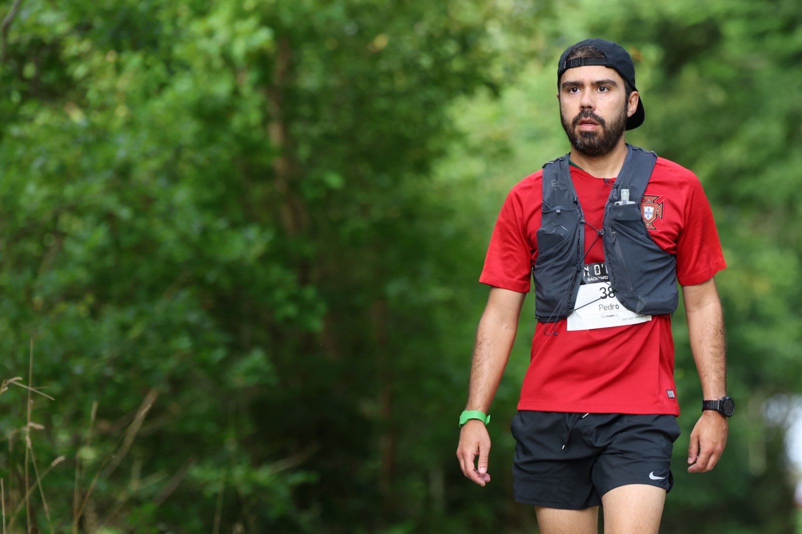

I'm an AI engineer and leader based in Copenhagen. I build AI products that put domain experts at the center - a way of working I call [Domain Driven AI](/blog/domain-driven-ai/): embedding experts into the development loop from prototype through validation. I've applied it across legal, financial, and philanthropic sectors.

My work spans the full arc of AI products: from first prototype to production systems serving thousands of daily users, and from working solo to building and leading engineering organizations.

If you'd like to follow along, the best way is my [newsletter](/newsletter/).

Currently I'm the Principal AI Engineer, Group at [Karnov Group](https://karnovgroup.com), where I rejoined in 2022 as the sole AI engineer and grew the AI organization to ~20 people. There I've built two products from scratch: **KAILA**, a GenAI legal research assistant used daily by 20,000+ users across four markets - featured in [Berlingske](https://www.berlingske.dk/virksomheder/kunstig-intelligens-er-for-alvor-rykket-ind-paa-advokatkontoret-vi-er) and [Børsen](https://borsen.dk/nyheder/tech/dansk-virksomhed-fra-1867-gar-i-offensiven-med-ai) - and **FLOW**, a multi-agent legal workflow suite launched in 2026.

Before AI, I was a Software Engineer (2012-2018) in Copenhagen, building software for the largest banks in the Nordics and for the Danish Public Transport (DOT). I've contributed to React Native with a [library](https://github.com/pmadruga/react-native-clean-project) with 1300+ stars on Github, and won 3rd place in React Europe's hackathon 2018 edition. I've also worked as a Data Analyst, with work featured on [Business Insider](https://www.businessinsider.com/the-worlds-20-most-bike-friendly-cities-2013-4).

I have an engineering background: Computer Engineering studies in the early 2000s, followed by a Master's Degree in Environmental Engineering (specialization in Environmental Impacts) from NOVA University Lisbon.

I love spending time with my family, running, and reading books. I have run a couple of marathons and one ultra-marathon. Here's me ~~running~~ walking in the ultra-marathon (2023):


