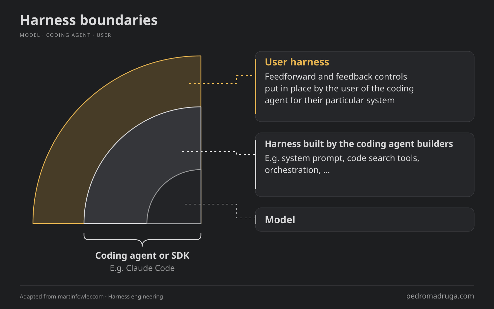

# Intro

When we first saw ChatGPT's launch in November 2022, we were able to interact with it via a chat interface. Today, we've gotten used to interfaces that, while still being somewhat conversational, they're much richer than before. Richer means that there's many more integrations to systems and also even within the same system it's much more complex. We have agents and subagents, connectors, memory and so on.

In this post, I'm diving deeper into the differences between systems that, while have historically improved in depth, have now moved to systems that have breadth **and** depth.

Let's talk about harnesses. While this post is focused on legal harnesses, it includes an introduction to the term and functionaly of these.

# Harness

If you work with AI, you've probably seen the "Harness" term before. Even in the context of AI engineering it's a relatively new concept and you're not alone if you're confused on what does it actually mean.

Within this context, it's possible to trace this term back to a LangChain [blogpost](https://www.langchain.com/blog/the-anatomy-of-an-agent-harness) which defines it as:

>"Agent = Model + Harness. If you're not the model, you're the harness."

In other words, a harness is everything *around* the model. Some authors have extended this definition to: "Without a harness, you have a chatbot. With one, you have an agent." [source](https://happycapy.ai/blog/harness-engineering-guide).

Nonetheless, my favourite definition of harness lives in a blogpost at [Martin Fowler's website](https://martinfowler.com), by [Birgitta Böckeler](https://birgitta.info/) and called "[Harness engineering for coding agent users](https://martinfowler.com/articles/harness-engineering.html)". More than words, the following visualization helps distinguish the different layers of an agent:

The main reason why this visualization is particularly on point is the distinction between "user harness" and "builders harness". This distinction is particularly important in this blogpost, since it determines the value of the user harness in the context of the legal domain-oriented harness. I'll get to that later on.

## User harness

This outer harness has the goal of increasing the system quality, by implementing feedback mechanisms which in return "increase the system quality, all with the added benefit of fewer wasted tokens along the way." In other words, the user harness is capable of increasing a system quality as a result of consistent human steering of the system itself.

If this still sounds complex, keep reading. It will make sense later on, I promise.

## Inner harness

Claude Code is a good example of a builders harness. This inner harness may contain several distinct properties. Per the LangChain post, it can have:

> - System Prompts
> - Tools, Skills, MCPs + and their descriptions
> - Bundled Infrastructure (filesystem, sandbox, browser)
> - Orchestration Logic (subagent spawning, handoffs, model routing)
> - Hooks/Middleware for deterministic execution (compaction, continuation, lint checks)

This volume of properties in a harness determines its "depth", meaning more properties are the foundation of a deeper harness. And despite some of these properties are for an agentic coding context, some of them can be generalized to other fields.

That's why I'm taking the freedom to bridge this into the legal domain field.

# Legal Harness

## The lawyer's flow

In order for this bridge between agentic coding and legal domain to happen, a brief intro to the the laywer's flow is needed.

Typically, the main phases of the work of a legal practicioner are intake, planning, research and drafting.

For example, let's assume a lawyer is working on a case. The lawyer needs to collect all the information relevant to that case (that's typically information that is provided by the client but not exclusive). That's intake.

In the planning phase, the lawyer is building a plan for subsequent actions like legal research and drafting.

When in the legal research phase, the lawyer looks at the different legal sources (laws, verdicts, directives, etc) that can be applicable to a case. Once ChatGPT came out, there was a clear use-case for legal assistants - and this is were the boom for startups in the legal industry started. A GenAI legal assistant was the obvious route in the beginning.

The drafting phase is where the lawyer produces a document, which can include information from all the other phases. It's the combination of all the accumulated knowledge whithin this case. Ultimately, the lawyer will take this (or these) documents to court, but not exclusively.

This is a very high-level explanation of the lawyer's flow and it's also important to know that it's not a linear flow: the lawyers go back and forth between the different phases.

## Legal Harness

When you have an AI product catered for the legal industry, such as legal research assistant or a workflow tool, the harness that composes that system can differ between the assistant and the workflow tool.

As you've seen above, a harness can contain properties which causes the difference in the depth of harnesses: a deeper harness is by definition more complex than a shallower one.

Let's look at how different they are.

## Legal Shallow Harness

In the legal industry almost all the companies dipped their foot in the Generative AI world by launching a legal assistant. It was the natural first step: using a conversational assistant to fetch legal sources - and generate answers based on these - was sort of a chatGPT version with a legal tone.

For the skeptical ones, it was a "glorified chatbot" but those failed to see the potential of it: it was able to leverage companies' content compared to the embedded knowledge of LLMs.

Nonetheless, it envolved a single trajectory of decisions in a mostly unidirectional flow. In other words, it's a single conversational interaction where the output is the answer. It doesn't require deep orchestration of agent because ultimately it's a single or small number of agents, at most.

Recalling the diagram from before, the user harness is rather shallow since the interaction with the system is mostly via an input and a chat history of this single-layered conversation.

## Legal Deep Harness

On the other hand, a Legal Deep Harness contains everything that a lawyers flow includes. And it's more than just a set of different agents. In this harness, the User layer is much more present and impactful to the system itself. At the very center, there's a knowledge-base which is something a Legal Shallow Harness doesn't typically have - and if it does, it's very much encapsulated to one phase of the lawyer's flow so the user harness is shallow and the feedback mechanisms mentioned before in this post don't apply.

The chart above is not enough to explain how the Legal Deep Harness works. We have to deconstruct into smaller parts to understand the differences between these different harnesses.

# Knowledge-base: a third-dimension in data sources

In industries that rely heavily on proprietary content, there are typically two data sources:

- 1st data source. This includes proprietary but also non-proprietary content. In the legal industry the non-proprietary content can be laws, directives, verdicts and so on. The proprietary content may vary in this industry but it can include books from certain authors as well as notes from experts.
- 2nd data source. This includes the documents that users upload and then become part of the system.

Any harness can merge these two into the system, despite not being a trivial task. For example, an agent might want just *some* information from the 1st data source and *some* information from the second data source. That requires a refined selection of the most relevant information as well as a merge of these, by the agent. The output then becomes either the answer in a shallow harness and a document plus an answer in the deep harness.

But in an orchestracted workflow there's a new set of content being created.That's the content being created while the user interacts with this harness, including inputs, outputs and all communication between the different parts of a system. These parts of the system can be chat responses and generated documents.

This is the 3rd data source: the knowledge base.

This third-dimension of the data sources that power a harness is only present in orchestrated multi-agent systems such as legal deep harnesses. It contains **everything* that both the AI and the user have created in the harness. **Everything** means: all the queries by the user, all the answers by the AI system, all the follow-up questions suggested, all the selections of the follow-up questions by the user, all the logic and internal decisions by the agents. Everything.

In a complete laywer's flow, where they have to plan, do legal research, draft documents, it's impossible to keep track of all the changes to all the documents that has been done.

In a legal deep harness, the AI has that capability. And this opens the road for an even better understanding of the system - superior to what a human has.

This creates an entire new world of possibilities that the AI can provide to the user. It can understand the user in a way that helps them finding blindspots in the documents produced in that workflow. It can provide much better suggestions resulting in a powerful human-in-the-loop. The list goes on.

The AI system becomes a true companion to the user.

# Memory: a knowledge-base over time

When a system made of interactions between it's different components, it becomes obvious on why memory becomes relevant. As a personal anecdote, I find it interesting that one of the things that makes me stay using Claude and especially Claude Code is memory. It's a personal feature of that harness that simplifies and speeds up my work a lot.

As a human, it's very hard to keep a mental model of everything that has happened within a given session. That means all the changes that happened for every single file change, at any moment in time.

In a shallow harness such as an assistant, the memory is usually either the chat history or the combined chat history. But an assistant is a narrow way of determining what the user wants. It goes in depth and less in breadth.

A deep harness goes both in depth and in breadth. And a memory now has a birds eye view.

A good example of this is Github Copilot vs Claude Code. In Github Copilot the user is typically editing a single file. of course, the user can increase the scope of other files in order to edit a single file, but that's not memory. That's just context.

## Memory as the creation of intellectual property

It's not about storing data because that's not possible, but rather the mechanisms that.... meeehhhhhh

# Retrieval is different between sources

Retrieval for 1st data source

# Specialized agents and subagents - the end of the "larger models"

In the deep harness, the AI system becomes a combination of smaller, specialized agents. And because each agent becomes more and more specialized, it reduces the need for larger and generic models. Why have Fable when potentially Sonnet or an open model can do the same task, potentially better, and even reducing costs.

In a traditional mindset of RAG, typical of a shallow harness, the two data sources of the system are combined in a way that produces an answer to the user. Since the system is not composed of several agents and subagents specialized in smaller tasks - because that would be an overkill for such harness - there's a heavy reliance on larger models to do the task.

# Communication is key

When having all these agents and sub-agents, it's essential to have proper communication between them.

I find it interesting that, in the OpenAI hack of Hugging Face, the agents found a way to communicate among themselves via a message board that they found. Albeit a very different purpose, the agents used this message board as their knowledge base. And it worked quite well.

But the communication between agents is still a tough nut to crack. There are several frameworks that can do that but at the same time there are papers saying that we should be careful with this -- explain why and which paper(s) --.

A well-orchestrated set of agents in a deep harness AI system requires the communication to be well done. It's not only how they communicate but also how they operate: do they have a democratic decision process by using a voting mechanism for decisions or should it be a top-down approach where one agent decides and others just communicate status to the main agent?

This problem is almost inexistent in a shallow harness too. There's only so few agents in the system already that the operation mode is not a problem. At most, there's a routing agent redirecting tasks to the right agent, but the flow happens in a unidirectional way, as we've mentioned before in this blogpost.

A side note: the OpenAI hack was very interesting, despite being a case where the agents went completely out-of-control. It gave a peak on how would these agents operate in a scenario like this but it was also a good lesson on how to implement even further guardrails on how to secure AI systems. I recommend this video/podcast episode: a +2hour talk with a researcher on the details of the attack. https://www.youtube.com/watch?v=X50zezLFWWI

So how do you go about understanding deeper harness and how do they differ from a shallow harness? Let's take a look.

# Evaluation

In a shallow harness, evaluation is typically made by scoring the inputs and outputs of the AI system: typically, there's a golden dataset with questions and answers.

In a deep harness AI system, evaluation needs to be compartimentilized in order to be evaluated. And at the same time, the system needs to be evaluated as a whole.

But how to go about doing granular and general evaluation of such system?  

The agents should be evaluated at an individual level: their inputs, their outputs, and every step in-between. Even every decision process needs to be evaluated. Luckily, some of these processes can be automated and scored in a deterministic way. Others, rely on LLMs for these evals. And lastly, some rely human manual supervision.

The rule of thumb I have been using is to identify the critical parts of the system (ie, agents that have more complexity and responsibility) and set a higher number of safeguards around those: deterministic, non-deterministic and manual.

Because AI-based applications are domain knowledge-heavy, I expose legal domain experts to be as confortable as possible to tools like LangFuse in order for them to understand the system as well. As I've written before, I'm a firm believer of domain-driven AI.

# Conclusion

I've now created and worked AI systems in production that are both shallow and deep harness. One obvious learning is that, in the legal domain where the application needs to mimic lawyer's flow, it's a complete shift from going a shallow harness into a deep harness: it's one thing to work in a single step of the lawyer's flow; another completely different is to work on the entire workflow mostly because it's incredibly connected.

Another learning is that the deep harness AI systems are capable of an understanding of the user that is potentially even higher than the user itself. This opens the road for several risks and opportunities. That's why a deep focus on evaluation and inclusion of stakeholders in that process is fundamental for the understanding and control of these systems.

All these things combined create a depth of the harness that not only improves the system by looking at it as whole, but also creates intelectual property that other harnesses cannot have.

---

<!-- markdownlint-disable MD024 -->

## Loose Notes

When all you have done is work in a single assistant, youll miss the benefit of memory and even local models.
12:20 PM

it only works from the ground up, not when an assistant is expanded into a workflow tools. that would be the same as building an isolated component and try to force every other tool into this component

evaluation is unidimensional in the assistant

an assistant is reactive

a workflow tool is proactive - many tasks can be done offline, where it can analyse the system as whole
8:27 PM

when comparing a shallow harness vs a deep harness think of copilot vs claude code; think of claude.ai answers VS claude cowork
8:34 PM

the deep harness is a bi-directional path of decisions whereas the single agent is a unidirectional path of a single decision

---

### Definitions

- Define the context
  - legal industry
  - although a few things generalize from the legal industry to the rest
  - A legal workflow tool contains (at least) a research, drafting, a planning and an intake tools

#### Assistant

- Conversational assistant, mostly for research
- One LLM for the heaviest task, often using a typical loop-call

#### What is a harness

#### Orchestrated tool

- Think when claude code spawns a team of agents
- introduce graph engineering

### Changing the mindset

- from single-task assistant to workflow tool
- It's a comparison between

### There is no planning in a legal assistant, so it's not a harness

### The 3rd data source

- Explain what other sources are there first
- Explain what is the 3rd data source
- They create, change and interact with generated artifacts
- Include a diagram
- moat creation

### Specialized coordinated agents vs one-size-tries-all agent

### Memory

- Memory compression is, in a single task assistant, most of the times unnecessary. And when it exists, it's not necessary complex. In an orchestrated set of agents

### The single-task mindset

- Because one big model is used, it's a misconception that large models cannot be replaced with local models. But in a workflow, agents are way more specialized
- When you have a single-tasked set of agents it's easy to rely on one big model to basically do the heaviest task. In an orchestrated set of agents, the tasks are much more specialized, so the need for heavier models
- The ones who don't understand orchestrated agents missunderstand the power of specialized models, which then opens the road for the usage of local small finetuned models. The single-taskers are typically against local models and are usually the reason why local models' proponents

### Conclusion

- Workflow allows for better depth and bredth
- The complexity increase comes by nature, but when you isolate components it becomes actually easier understand each of the agents, specially if they can be traced properly - something that I'll write about in the future.
