## Intro

When we first saw ChatGPT's launch in November 2022, we were able to interact with it via a chat interface. Today, the interfaces where we interact with LLMs seem different, despite at the surface looking similar to what it was back then.

These interfaces seem more complex now - a surface reflection of what they have become under the hood. There are agents, subagents, connectors, memory and so on. The breadth of capabilities around the model has increased exponentially whereas at the same time the models' quality (ie, depth) has also gone up over the years.

In this post, I'm diving deeper into the differences between systems that, while they have historically improved in depth, have now moved to systems that have breadth **and** depth.

Let's talk about harnesses.

## Harness

### What is it?

You've probably seen the "Harness" term before. Within agentic coding it's a new concept but exponentially increasing in popularity.

You're not alone if you're confused about what it actually means. So let's start with defining a harness in the context of agentic coding.

I first saw this term in a [Claude blogpost](https://claude.com/resources/articles/building-agents-with-the-claude-agent-sdk) in September 2025, although a LangChain [blogpost](https://www.langchain.com/blog/the-anatomy-of-an-agent-harness) from March 2026 defines a harness as:

>"Agent = Model + Harness. If you're not the model, you're the harness."

In other words, a harness is everything *around* the model, and it can have several layers.

My favourite definition of harness lives in a blogpost at [Martin Fowler's website](https://martinfowler.com), by [Birgitta Böckeler](https://birgitta.info/) and called "[Harness engineering for coding agent users](https://martinfowler.com/articles/harness-engineering.html)". That article dives into the complexity of these harnesses and also refers to a new term called "harness engineering" - but that's out of scope here.

In order to explain what a harness is, the author creates a visualization of the different layers around the model:

The harness gets broken down into two layers: "harness outer layer" and harness built by the builders - which I'm naming here as "harness inner layer". Let's define what each of these layers of the harness is.  

### Harness inner layer

From an agentic coding standpoint, Claude Code and Codex are good examples of a builder's harness - or "harness inner layer". This layer may contain several distinct properties. Per the same [LangChain post](https://www.langchain.com/blog/the-anatomy-of-an-agent-harness), it can have:

> - System Prompts
> - Tools, Skills, MCPs + and their descriptions
> - Bundled Infrastructure (filesystem, sandbox, browser)
> - Orchestration Logic (subagent spawning, handoffs, model routing)
> - Hooks/Middleware for deterministic execution (compaction, continuation, lint checks)

The list goes on. This layer contains all the tooling necessary for the harness to function as a whole and it's the layer closest to the model for a reason: it interacts the most with it.

### Harness outer layer

On the other hand, a harness outer layer plays a different role: it works as a two-way feedback mechanism between the user's interactions and the entire harness combined. As the author mentions, there are feedforward and feedback mechanisms that "ultimately it should reduce the review toil and increase the system quality".

In other words, the harness outer layer is capable of increasing a system's quality as a result of consistent human steering of the system itself, plus the properties mentioned above.

### Shallow and Deep Harness in agentic coding

We've dived into the different layers of a harness and it's now obvious that different layers have different depth: some are shallow, some are deep.

The volume and complexity of properties and mechanisms in a harness determine its depth. If the inner layer and the outer layer are deep enough, then the difference in what the AI system is capable of becomes noticeable.

The layers - and their depth - are what make applications like ChatGPT, Codex, Claude Code and others rich in terms of functionality, despite the UI being "just" a conversational interface.

Up until now, I've been mentioning harnesses in the context of agentic coding (and harness engineering). In the following chapters, we're looking under the hood of legal harnesses with different depths - and how this difference in depth creates fundamentally distinct harnesses.

We need a bridge between agentic coding and legal harnesses.



## Legal Harness

### The lawyer's flow

In order for this bridge between agentic coding and legal domain to happen, a brief intro to the lawyer's flow is needed. This is because it determines the foundation of how the legal harness is composed and how its depth varies.

Especially, when comparing a single tool that a lawyer uses compared to an entire set of workflow tools, the difference is night and day.

So how does a lawyer work? What's their flow?

For the sake of simplicity, and because not everyone reading this has legal domain expertise, I'm keeping the explanation at a high level.

Typically, the main phases of the work of a legal practitioner are defined as: intake, planning, research and drafting.

For example, let's assume a lawyer is working on a case.

The lawyer needs to collect all the information relevant to that case: information from the client and so forth. That's intake.

In the planning phase, the lawyer is building a plan for subsequent actions like legal research and drafting.

When in the legal research phase, the lawyer looks at the different legal sources (laws, verdicts, directives, etc) that can be applicable to the case.

The drafting phase is where the lawyer produces a document. It can include information from all the other phases. It's the combination of all the accumulated knowledge within this case. Ultimately, the lawyer will take this (or these) documents to court. Again, I'm simplifying here.

Also, it's not a linear flow: the lawyers go back and forth between the different phases. They iterate and improve.

This flow with the different phases serves as the foundation of the legal harness. After all, as I've written before, [Domain Driven AI](/blog/domain-driven-ai) means that the AI follows the domain: in order to produce better results in such knowledge-heavy industry as the legal, it's necessary to build AI systems that reflect that knowledge.

### Legal Harness

Because the lawyer's flow has different phases - and because we're using a Domain Driven AI approach -, it's necessary to understand how to build harnesses that reflect that flow.

As we've seen before, the two layers that compose the agentic coding harness - the inner layer and the outer layer differ substantially when creating a legal harness. This is because these layers need to reflect which phase(s) of the lawyer's flow they are in. The more phases, the deeper the complexity, the deeper the layers of the harness.

By now, it's becoming clear that an AI system whose harness is built for a legal research phase is completely different than an AI system built to power an entire workflow (ie, all the phases). What we're missing so far is exactly what those differences are.

### Shallow Legal Harness

In the legal industry almost all the companies dipped their foot in the Generative AI world by launching a legal assistant. It was the natural first step: using a conversational assistant to fetch legal sources, and generate answers based on these same sources.

A good legal assistant was able to leverage companies' content compared to the embedded knowledge of LLMs and, because LLMs tend to hallucinate quite a lot and, in an industry where factuality is critical, it only made sense to have a legal research assistant. Something trustworthy.

A conversational legal research assistant works in a mostly unidirectional flow: user asks a question and gets an answer, based on sources. And that works well for that specific use-case: a user needs clarification and the assistant provides an answer based on legal citations.

It's assistive: user prompts, assistant answers.

Its primary goal is not to generate documents, despite being able to potentially create a document of several different pages. Even if an answer is able to generate such, it doesn't scale to large documents: 4 pages could work, 20 pages would not.

At least without creating too much synthetic content, but in the legal domain that could mean creating either noise or - even worse - hallucinations. Keeping it short is what makes the legal assistant shine.

Nowadays, UIs have improved and there are editing tools embedded as well as several other strategies that *try* to improve the process, but it feels hacky.

Recalling the diagram from before, with the different layers of a harness, the legal harness's outer layer of a single workflow tool like the legal research assistant is rather shallow since the interaction with the system is mostly via an input.

That's why it is a Shallow Legal Harness.

The legal research tool is fundamentally important and central to the rest of the workflow but the lawyer's workflow is very much interconnected between the different phases. Nonetheless, a conversational legal research assistant is simply one small piece of the lawyer's workflow.

In reality, this workflow is composed of many tools that reflect how lawyers work.

Let's now look at the different parts that an AI system's architecture contemplated from the ground up in order to reflect the lawyer's workflow as closely as possible.



## Deep Legal Harness

A Deep Legal Harness contains everything that a lawyer's flow includes. And it's more than just a set of different agents. In this harness, the user layer is much present and impactful to the system itself.

This is because the user can now interact with several agents and sub-agents.

To add to the complexity, the changes in one side of the system need to be propagated to the rest of the system, and then the system returns back: the feedforward and feedback mechanisms we've talked about before.

How to make this system communicate between these tools - and to the user?

This is where the knowledge base comes in, and it's probably the key differentiating factor between a Deep Legal Harness and a Shallow Legal Harness.

Side note: this could typically be called "memory", but knowledge base in this context refers to a snapshot of the entire system at a single point in time. Memory comes later in this article. End of side note.

This is what a Deep Legal Harness looks like, from a high-level perspective.

For the sake of simplicity, there are parts being omitted in this visualization, because this harness is more complex than what's being represented. There are many more variables at play that make the harness deep.

In order to understand what makes a Deep Legal Harness to be considered deep, we have to deconstruct its architecture into several small parts. These parts are the major focus of the rest of this article.



### Knowledge base: a third-dimension in data sources

Shallow Legal Harnesses are usually composed of two data sources:

- 1 data source: This includes proprietary but also non-proprietary content. In the legal industry the non-proprietary content can be laws, directives, verdicts and so on. The proprietary content may vary in this industry but it can include books from certain authors as well as notes from experts.
- 2 data source: This includes the documents that users upload and then become part of the system.

Any harness can (and has to) merge these two into the system, despite not being a trivial task.

For example, an agent might want just *some* information from the 1 data source and *some* information from the second data source. That requires a refined selection of the most relevant information as well as a merge of these, by the agent(s). The output then becomes either an answer to the user in a Shallow Legal Harness or a document **plus** an answer in the Deep Legal Harness.

But in a thick-layered orchestrated workflow as this harness, there's a new set of content being created. That's the content being created while the user interacts with this harness, including inputs, outputs and all communication between the different parts of a system.

This is the 3 data source: the knowledge base.

Specifically, the knowledge base contains **everything** that both the AI and the user have created in the harness. **Everything** means: all the queries by the user, all the answers by the AI system in every single phase, all the documents generated, all the edits to a document or set of documents, all the follow-up questions suggested, all the selections of the follow-up questions by the user, all the logic and internal decisions by the agents.

It really is everything that happens at both the inner and outer layer of a legal harness. Every single modification to the AI system is included in the knowledge base. This is a "mental" model that a human cannot have.

In the lawyer's flow - where they have to plan, do legal research, draft documents - it's impossible to keep track of all the changes that the lawyer performed over a case.

But in a Deep Legal Harness, the AI has that capability, thus opening the road for an even better understanding of the system - superior to what a human has.

This creates an entirely new world of possibilities that the AI can provide to the user. Here are some examples of what it can do:

1. Understand the user in a way that helps them find blind spots (for example) in the documents produced in that workflow;
2. Provide transparency to the user on the decisions by the system. For example, the reasoning in the outputs can be enhanced by the knowledge base to become more concrete and context-relevant, especially knowing that [the default reasoning of models doesn't always reflect what these models really think](https://www.anthropic.com/research/reasoning-models-dont-say-think).  
3. Provide much better suggestions resulting in a drastically more powerful and all-knowing human-in-the-loop;
4. Create "adversarial lawyering" scenarios where (for example) a defence lawyer can generate the documents a prosecution lawyer would create - and then compare and improve its own documents.
5. Create 1 and 2 data source retrieval that is far superior to the Shallow Legal Harness, where the knowledge base is either weak or nonexistent.

The list goes on.

The companies who succeed at implementing these and others, will be able to surpass any generic harness.

Only a Deep Legal Harness with a well-thought knowledge base has a complete picture of the system at a given point in time. And a well-thought knowledge base needs to be conceptualized from the ground up when building such harness.

Scaling from a Shallow Harness to a Deep Harness does not happen easily because in a Deep Harness the knowledge base makes everything in the harness work together, since day one. Any other route creates a "Frankenstein" harness where capabilities are added at different stages, and probably disconnected.  

Nonetheless, the main take is that the knowledge base handles a cognitive model bigger than the human. In this scenario, the AI system becomes a true companion to the user.

### Memory: a knowledge base over time

I keep using Claude, and especially Claude Code, because of how it handles memory. It's a personalized feature of that harness that simplifies and speeds up my work a lot.

In some ways, it has an ability to "understand" the most important parts of my interaction with the harness - and use it to improve my experience. Again, the feedforward and feedback mechanism visibly at play here.

If we think of the knowledge base as a snapshot of the system at a given time, then memory is the combination of all the snapshots: it's a movie of everything that has happened over time within the AI system - and with the user.

In a Shallow Legal Harness such as an assistant, the memory is usually the chat history of a session. Chat history can be considered a 3 data source but it's a very thin one.

A Shallow Legal Harness has a narrow way of determining what the user wants, mostly based on the conversation's history and not much more. In other words, it has a ceiling on what can be done.

Nonetheless, a Shallow Legal Harness may work in depth (ie, in a single task of a single tool of the lawyer's flow), but rarely in breadth (ie, in several tasks over multiple tools).

On the other hand, a Deep Legal Harness goes both in depth and in breadth: it's a complete understanding of the system.

An analogy to this depth and breadth is GitHub Copilot and Claude Code. In GitHub Copilot the user is typically editing a single file. Of course, the user can increase the scope to other files in order to edit a single file, but that's not memory - that's just context.

This is why Claude Code is so appealing: it's not just context but rather a combination of all the properties of a harness, working well together. That's memory at play: a combination of properties working symbiotically to provide the user the best possible experience through an AI system aware of its preferences.

If we take into account the different types of memory - [short-term, episodic, semantic and procedural](https://arxiv.org/pdf/2309.02427) -, it's in a Deep Harness where these different types can be more properly populated due to the volume of data created in this type of AI systems.



### Retrieval is different between sources

We saw before the three types of sources in a Deep Legal Harness. Because sources are so different from one another, it's necessary to have different information retrieval logic for each source.

This is because each type of source is parsed, indexed, and enriched in different ways. And that makes sense because they serve different purposes: an uploaded document serves a different purpose than the knowledge base, and so on.

The reality is that those retrieval steps exist and they're essential. But most importantly, in a Deep Legal Harness they have to be well-connected among them, since they need to retrieve content in the context of the harness, and not isolated from one another.

And once they've been retrieved, these sources need to be merged in a way that makes sense to both the system and especially the user. This topic alone deserves a topic on its own.

Note: in the diagram of the Deep Legal Harness from before, there are retrieval steps (typically performed by agents) that have been omitted, in order to keep the simplicity of the document.

### Specialized agents

In the Deep Legal Harness, the AI system becomes a combination of smaller, specialized agents. As each agent becomes more and more specialized, it reduces the need for larger, generic models.

For example: why have Claude Fable when potentially Sonnet or an open model can do the same task, potentially better, and even reducing costs?

In a Shallow Legal Harness, it's quite normal to have a "large generic model" that does the heavy lifting of its context-heavy tasks. However, dropping the content of three data sources into the context of an LLM has its ceiling - even using different information retrieval approaches -, in a phenomenon called "[context rot](https://www.trychroma.com/research/context-rot)" happening as input text grows.

In a Shallow Legal Harness, where the system is not composed of several agents specialized in smaller tasks, there's a heavy reliance on a large model to do the task. It would be an over-engineering task to try to fit smaller models to handle a relatively simple output.

In a Deep Legal Harness the agents are specialized. This means that there's no need for generic LLMs to perform focused tasks. This is also why some companies in the legal industry (like Harvey, Thomson Reuters and Noxtua) are post-training their own models.

These specialized models can also be simpler to evaluate. Let's look at that.



### Evaluation

For a large majority of systems, evaluation is conventionally made by scoring the inputs and outputs of the AI system, based on a golden dataset with questions and answers.

In a Deep Legal Harness AI system, evaluation needs to be compartmentalized in order to be evaluated. And at the same time, the system needs to be evaluated as a whole.

So how can a system be evaluated in a compartmentalized way? You have to break the system into a thousand pieces - and only then evaluate each part and the system as a whole.  

The agents should be evaluated at an individual level: their inputs, their outputs, and every step in-between. Even every decision process needs to be evaluated. Luckily, some of these processes can be automated and scored in a deterministic way. Others rely on LLMs for these evals. And lastly, some rely on human manual supervision.

The rule of thumb I have been using is to identify the critical parts of the system (ie, agents that have more complexity and responsibility) and set a higher number and deeper level of safeguards around those: whether deterministic, non-deterministic and/or manual.

Because AI-based legal applications are domain knowledge-heavy, I expose legal domain experts to be as comfortable as possible to tools like [Langfuse](https://langfuse.com/) in order for them to understand the system - both as a whole as well as each individual part of it.



### Communication is key

In a Deep Legal Harness where there are several agents at play, it’s essential to have proper communication between them.

I find it interesting that, in the OpenAI hack of Hugging Face, the agents communicated among themselves via a message board that they found. Albeit a very different purpose, the agents used this message board as their knowledge base. And it worked quite well (for the agents).

A well-orchestrated set of agents in a Deep Legal Harness AI system requires the communication to function properly, and also how they decide (ie, which tools to use, which context to include, etc).

When there are several agents at play, and communicating amongst themselves, the outcome of these should be the result of a decision process. To name a few options, they can be [democratic](https://arxiv.org/abs/2512.08296), [top-down](https://arxiv.org/abs/2502.19130), etc.

There are several decisions to be made when setting up the communication between agents and their outcome: Should they have a democratic decision process by using a voting mechanism for decisions or should it be a top-down approach where one agent decides and others just communicate status to the main agent? And these are to name a few options.

This problem is almost non-existent in a Shallow Legal Harness too. There are so few agents in the system already that the decision process is not a problem. At most, there’s a routing agent redirecting tasks to the right agent, but the flow happens in a unidirectional way, as we've mentioned before in this blog post.

A side note: the OpenAI hack was very interesting, despite being a case where the agents went completely out-of-control. It gave a peek into how these agents would operate in a scenario like this but it was also a good lesson on how to implement even further guardrails on how to secure AI systems. I recommend this video/podcast episode: a 2+ hour talk with a researcher on the details of the attack. https://www.youtube.com/watch?v=X50zezLFWWI

## Conclusion

It's possible to create a legal harness, using agentic coding harness as its foundation.

A lot can be learned when building a custom harness. It provides an understanding of the system that a generic harness cannot give - regardless of being shallow or deep.

But with value comes complexity along.

A Deep Legal Harness tries to mimic the lawyer's flow to what's possible. In the same way that that flow is complex, so is a Deep Legal Harness.

In the legal domain where a workflow application needs to mimic lawyer's work, we're looking at a complete shift from going from a Shallow Legal Harness into a Deep Legal Harness. One thing is to work in a single step of the lawyer's flow; another completely different is to work on the entire workflow mostly because it's the result of the interaction of the tools (and the tools with the user).

The end result is a rich AI system, that provides mechanisms for the user to be in control while helping the same user at performing its tasks. The Deep Legal Harness AI systems are capable of an understanding of the user that is potentially even higher than the user itself.

This opens the road for several risks and opportunities. That's why a deep focus on evaluation and inclusion of stakeholders in that process is fundamental for the understanding and control of these systems.

Further articles on Deep Legal Harness could expand on each of the topics addressed here such as memory, evaluation, specialization and communication since this article only addresses them on a high-level.

