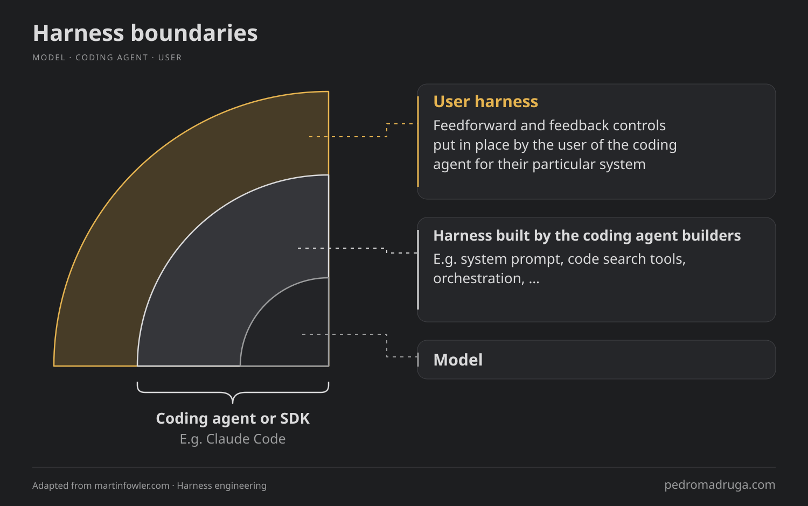

## Intro

When we first saw ChatGPT's launch in November 2022, we were able to interact with it via a chat interface. But the interfaces where we interact with LLMs seem different, despite at the surface looking similar to what it was back then.

These interfaces seem more complex now. And that's because they have become so under the hood. There are agents, subagents, connectors, memory and so on. The breadth of capabilities around the model have increased exponentially whereas at the same time the models' quality (ie, depth) have also gone up over the years.

In this post, I'm diving deeper into the differences between systems that, while have historically improved in depth, have now moved to systems that have breadth **and** depth.

Let's talk about harnesses.

## Harness

### What is it?

If you work with AI, you've probably seen the "Harness" term before. In the context of agentic coding, it's a new concept that has been popping up quite often. You're not alone if you're confused on what does it actually mean.

So let's start with defining a harness in the context of agentic coding. Historically, this term can be traced to a LangChain [blogpost](https://www.langchain.com/blog/the-anatomy-of-an-agent-harness) from March 2026, which defines a harness as:

>"Agent = Model + Harness. If you're not the model, you're the harness."

In other words, a harness is everything *around* the model. But a harness can have several layers.

My favourite definition of harness lives in a blogpost at [Martin Fowler's website](https://martinfowler.com), by [Birgitta Böckeler](https://birgitta.info/) and called "[Harness engineering for coding agent users](https://martinfowler.com/articles/harness-engineering.html)". The article dives into the complexity of these harness and also refers a new term called "harness engineering" - but that's out of scope here.

In order to explain what is a harness, the author creates a visualization of the different layers around the model:

The harness gets broken down into two layers: "harness outer layer" and harness built by the builders - which I'm naming it here as "harness inner layer". Let's define what is each of these layers of the harness.  

### Harness inner layer

From an agentic coding standpoint, Claude Code and Codex are good examples of a builders harness - or "harness inner layer". This layer may contain several distinct properties. Per the same [LangChain post](https://www.langchain.com/blog/the-anatomy-of-an-agent-harness), it can have:

> - System Prompts
> - Tools, Skills, MCPs + and their descriptions
> - Bundled Infrastructure (filesystem, sandbox, browser)
> - Orchestration Logic (subagent spawning, handoffs, model routing)
> - Hooks/Middleware for deterministic execution (compaction, continuation, lint checks)

The list goes on. This layer contains all the tooling necessary for the harness to function as a whole and it's the layer closest to the model for a reason: it interacts the most with it.

### Harness outer layer

On the other hand, a harness outer layer plays a different role: it works as a two-way feedback mechanism between the user's interactions and the entire harness combined. As the author mentions, there are feedforward and feedback mechanisms that "ultimately it should reduce the review toil and increase the system quality".

In other words, the harness outer layer is capable of increasing a system quality as a result of consistent human steering of the system itself, plus the mechanisms mentioned above.

### Shallow and Deep Harness in agentic coding

We've dived into the different layers of a harness and it's now obvious that different layers have different depth: some are shallow, some are deep.

The volume and complexity of properties and mechanisms in a harness determine its depth. If the two layers mentioned above are thick, then the difference becomes noticeable.

And going back to the very beginning of this article where I mentioned that, despite the UI from ChatGPT remaining somewhat the same since 2022, we all understand that there's much more functionality under the hood. The layers and depth is what makes applications like ChatGPT, Codex, Claude Code and others rich in terms of functionality, despite that at the end of the day it's "just" a conversational interface.

Up until now, I've been mentioning harnesses in the context of agentic coding (and harness engineering). Today, we're looking under the hood of legal harnesses with different depths - and how they're fundamentally distinct harnesses.

But a legal harness has a context. Let's get to what that means.

## Legal Harness

### The lawyer's flow

In order for this bridge between agentic coding and legal domain to happen, a brief intro to the lawyer's flow is needed. It's imperative to understand how a lawyer works because it sets the foundation of how the legal harness is set up, how its depth varies - specially when comparing a single tool that a lawyer uses compared to an entire set of workflow tools.

So how does a lawyer work? What's their flow?

For the sake of simplicity, and because not everyone reading this has legal domain expertise, I'm keeping the explanation at a high level. It's still enough to bridge between this and the legal harness.

Typically, the main phases of the work of a legal practitioner are defined as: intake, planning, research and drafting.

For example, let's assume a lawyer is working on a case. The lawyer needs to collect all the information relevant to that case (that's typically information that is provided by the client but not exclusive). That's intake.

In the planning phase, the lawyer is building a plan for subsequent actions like legal research and drafting.

When in the legal research phase, the lawyer looks at the different legal sources (laws, verdicts, directives, etc) that can be applicable to a case.

The drafting phase is where the lawyer produces a document, which can include information from all the other phases. It's the combination of all the accumulated knowledge within this case. Ultimately, the lawyer will take this (or these) documents to court. Again, I'm simplifying here.

This is a very high-level explanation of the lawyer's flow and it's also important to know that it's not a linear flow: the lawyers go back and forth between the different phases.

Most importantly, this flow serves as the foundation of the legal harness. After all, as I've written before here, Domain Driven AI means that the AI follows the domain: in order to produce better results in such knowledge-heavy industry as the legal, it's necessary to build AI systems that reflect that knowledge.

It's now time to transpose this knowledge and create a legal harness.

### Legal Harness

Because the lawyer's flow has different phases - and because we're using a Domain Driven AI approach -, it's necessary to understand how to build harnesses that reflect that flow.

The two layers that compose the agentic coding harness - the inner layer (the builder's layer) and the outer layer (the user's layer) differs substantially when creating a legal harness. This is because these layers need to reflect which phase(s) of the lawyer's flow is in.

By now, it's becoming clear that an AI system whose harness is built for a legal research phase is completely different than an AI system built to power an entire workflow (ie, all the phases). What we're missing so far is exactly what those differences are. Something addressed later on in this article.

Let's look at how different they are.

### Shallow Legal Harness

In the legal industry almost all the companies dipped their foot in the Generative AI world by launching a legal assistant. It was the natural first step: using a conversational assistant to fetch legal sources, and generate answers based on these same sources.

A legal assistant was able to leverage companies' content compared to the embedded knowledge of LLMs and, because LLMs tend to hallucinate quite a lot and, in an industry where factuality is critical, it only made sense to have a legal research assistant. Something trustworthy.

A conversational legal research assistant works in a mostly unidirectional flow: user asks a question and gets an answer, based on sources. And that works well for that specific use-case: a user needs clarification.

If the goal is to extend it to create entire documents then the flow starts having flaws because the answer's intent is not to generate a document to be created. It may create a document with several pages - potentially even at double digits - but it doesn't scale to large documents. This is because a conversational assistant's goal is to generate answers - more than that is out of the initial intent.

Nowadays, UIs have improved and there's editing tools inline as well as several other strategies that *try* to improve the process. But even generating documents

Nonetheless, from a legal domain tooling standpoint, a conversational legal research assistant is simply one small piece of the lawyer's workflow. In reality, as discussed before in this blogpost, this workflow is composed of many tools.

A single tool in this workflow is disconnected from the entire workflow. The legal research tool is fundamentally important and central to the rest of the workflow but lawyer's workflow is very much interconnected between the different phases. We'll get to that in a bit.

Recalling the diagram from before with the different layers of a harness, the legal harness's outer layer of a single workflow tool like the legal research assistant is rather shallow since the interaction with the system is mostly via an input and a chat history of this single-layered conversation: it's lacking the richness of the user harness that other tools provide (when properly connected).

Next, let's see how it looks like when (almost) all the tools are present. But most importantly, let's see an AI system's architecture that has been contemplated from the ground up in order to reflect the lawyer's workflow as closely as possible.

### Deep Legal Harness

On the other hand, a complete Deep Legal Harness contains everything that a lawyer's flow includes. And it's more than just a set of different agents. In this harness, the user layer is much more present and impactful to the system itself.

This is because the user can now interact with many different tools (typically represented by agents and sub-agents). Most importantly, the changes in one side of the system need to be propagated to the rest of the system, and then the system returns back: the feedforward and feedback mechanisms we've talked before.

How to make this system communicate between these tools - and to the user?

This is where the knowledge-base comes in, and it's probably the major defining factor between a deep and a shallow harness - within a legal context, of course.
This is how a deep legal harness looks, from a high-level perspective.

For the sake of simplicity, there are parts (agents) being omitted in this chart, because it's much more complex than this. There are many more variables at hand that makes the harness deep.

But even at a high-level, this chart is not enough to explain how the Deep Legal Harness works. We have to deconstruct into smaller parts to understand what makes a deep legal harness to actually be considered deep.

## Knowledge-base: a third-dimension in data sources

In industries that rely heavily on proprietary content, there are typically two data sources:

- 1st data source: This includes proprietary but also non-proprietary content. In the legal industry the non-proprietary content can be laws, directives, verdicts and so on. The proprietary content may vary in this industry but it can include books from certain authors as well as notes from experts.
- 2nd data source: This includes the documents that users upload and then become part of the system.

Any harness can merge these two into the system, despite not being a trivial task when done right.

For example, an agent might want just *some* information from the 1st data source and *some* information from the second data source. That requires a refined selection of the most relevant information as well as a merge of these, by the agent. The output then becomes either the answer in a shallow harness and a document plus an answer in the deep harness.

But in an orchestrated workflow there's a new set of content being created. That's the content being created while the user interacts with this harness, including inputs, outputs and all communication between the different parts of a system. These parts of the system can be chat responses and generated documents.

This is the 3rd data source: the knowledge-base.

It contains **everything** that both the AI and the user have created in the harness. **Everything** means: all the queries by the user, all the answers by the AI system, all the follow-up questions suggested, all the selections of the follow-up questions by the user, all the logic and internal decisions by the agents.

It's a complete picture of the system at a given point in time.

In the lawyer's flow, where they have to plan, do legal research, draft documents, it's impossible to keep track of all the changes to all the documents that have been done.

But in a deep legal harness, the AI has that capability, thus opening the road for an even better understanding of the system - superior to what a human has.

Moreover, this creates an entire new world of possibilities that the AI can provide to the user. Here are some examples of what it can do:

1. Understand the user in a way that helps them find blind spots (for example) in the documents produced in that workflow;
2. Transparency to the user on the decisions by the system. For example, the reasoning in the answers to the user becomes much more concrete.  
3. Provide much better suggestions resulting in a drastically more powerful and all-knowing human-in-the-loop;
4. Create "adversarial lawyering" scenarios where (for example) a defence lawyer can generate the documents a prosecution lawyer would create - and then compare and improve its own documents.

The list goes on.

The main take is that the knowledge-base handles a cognitive model bigger than the human. In this scenario, the AI system becomes a true companion to the user.

## Memory: a knowledge-base over time

I keep using Claude, and especially Claude Code, because of how it handles memory. It's a personal feature of that harness that simplifies and speeds up my work a lot. It has an ability to "understand" the most important parts of my interaction with the harness - and use it to improve my experience. Again, the feedforward and feedback mechanism visibly at play here.

If we think of the knowledge base as a picture of the system at a given time, then memory is the combination of all the pictures. It's a movie of everything that has happened over time.

In a shallow harness such as an assistant, the memory is usually the chat history of a session. A single-task assistant is a narrow way of determining what the user wants: it may go in depth (in a single task of a single tool), but rarely in breadth (in several tasks over multiple tools).

A deep legal harness goes both in depth and in breadth: it's a complete understanding of the system.

An analogy to this depth and breadth is GitHub Copilot and Claude Code. In GitHub Copilot the user is typically editing a single file. Of course, the user can increase the scope of other files in order to edit a single file, but that's not memory. That's just context.

This is why Claude Code is so appealing: it's not just context but rather a combination of all the properties of a harness, working well together.

## Retrieval is different between sources

We saw before the three types of sources in a deep legal harness.

## Specialized agents

In the deep harness, the AI system becomes a combination of smaller, specialized agents. As each agent becomes more and more specialized, it narrows the need for larger and generic models. Why have Fable when potentially Sonnet or an open model can do the same task, potentially better, and even reducing costs?

In a traditional mindset of RAG, typical of a shallow harness, the two data sources of the system are combined in a way that produces an answer to the user. Since the system is not composed of several agents and subagents specialized in smaller tasks - because that would be an overkill for such harness - there's a heavy reliance on larger models to do the task.

## Communication is key

When having all these agents, it's essential to have proper communication between them.

I find it interesting that, in the OpenAI hack of Hugging Face, the agents found a way to communicate among themselves via a message board that they found. Albeit a very different purpose, the agents used this message board as their knowledge base. And it worked quite well.

But the communication between agents is still a tough nut to crack. There are several frameworks that can do that but at the same time there are papers saying that we should be careful with this -- explain why and which paper(s) --.

A well-orchestrated set of agents in a deep harness AI system requires the communication to be well done. It's not only how they communicate but also how they operate: do they have a democratic decision process by using a voting mechanism for decisions or should it be a top-down approach where one agent decides and others just communicate status to the main agent?

This problem is almost inexistent in a shallow harness too. There's only so few agents in the system already that the operation mode is not a problem. At most, there's a routing agent redirecting tasks to the right agent, but the flow happens in a unidirectional way, as we've mentioned before in this blogpost.

A side note: the OpenAI hack was very interesting, despite being a case where the agents went completely out-of-control. It gave a peek on how would these agents operate in a scenario like this but it was also a good lesson on how to implement even further guardrails on how to secure AI systems. I recommend this video/podcast episode: a +2hour talk with a researcher on the details of the attack. https://www.youtube.com/watch?v=X50zezLFWWI

## Evaluation

For most legacy systems, evaluation is typically made by scoring the inputs and outputs of the AI system, based on a golden dataset with questions and answers.

In a deep harness AI system, evaluation needs to be compartmentalized in order to be evaluated. And at the same time, the system needs to be evaluated as a whole.

But how to go about doing granular and general evaluation of such system?  

The agents should be evaluated at an individual level: their inputs, their outputs, and every step in-between. Even every decision process needs to be evaluated. Luckily, some of these processes can be automated and scored in a deterministic way. Others, rely on LLMs for these evals. And lastly, some rely on human manual supervision.

The rule of thumb I have been using is to identify the critical parts of the system (ie, agents that have more complexity and responsibility) and set a higher number of safeguards around those: deterministic, non-deterministic and manual.

Because AI-based applications are domain knowledge-heavy, I expose legal domain experts to be as comfortable as possible to tools like LangFuse in order for them to understand the system as well. As I've written before, I'm a firm believer of domain-driven AI.

## Conclusion

I've now created and worked with harnesses in production that are both shallow and deep harness. One obvious learning is that, in the legal domain where the application needs to mimic lawyer's flow, it's a complete shift from going a shallow harness into a deep harness: it's one thing to work in a single step of the lawyer's flow; another completely different is to work on the entire workflow mostly because it's the result of the interaction of the tools (and the tools with the user).

Another learning is that the deep harness AI systems are capable of an understanding of the user that is potentially even higher than the user itself. This opens the road for several risks and opportunities. That's why a deep focus on evaluation and inclusion of stakeholders in that process is fundamental for the understanding and control of these systems.

---

### The single-task mindset

- Because one big model is used, it's a misconception that large models cannot be replaced with local models. But in a workflow, agents are way more specialized
- When you have a single-tasked set of agents it's easy to rely on one big model to basically do the heaviest task. In an orchestrated set of agents, the tasks are much more specialized, so the need for heavier models
- The ones who don't understand orchestrated agents misunderstand the power of specialized models, which then opens the road for the usage of local small finetuned models. The single-taskers are typically against local models and are usually the reason why local models' proponents

### Conclusion

- Workflow allows for better depth and breadth
- The complexity increase comes by nature, but when you isolate components it becomes actually easier understand each of the agents, specially if they can be traced properly - something that I'll write about in the future.
